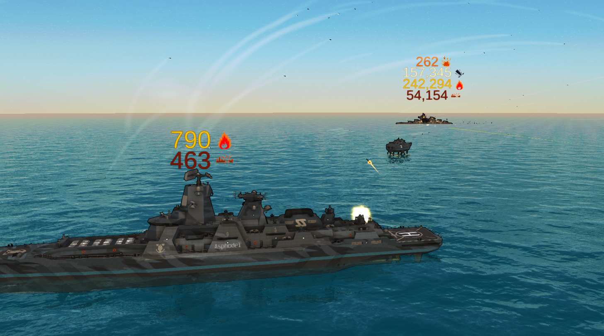

# Floating Damage Numbers - From the Depths Mod

Floating Damage Numbers adds optional, world-space combat feedback to [From the Depths](https://store.steampowered.com/app/268650/From_the_Depths/).

Damage received makes numbers appear above the ships. Damage types can be shown with colors and the game's damage icons.

## Features

- Simple Mode for a cleaner, consolidated view above each construct.
- Detailed Mode for hit-position-based numbers with spatial aggregation.
- Additional options for Damage Per Second counters.
- Damage-type colors and optional damage icons or text tags.
- Aggregation of rapid repeated hits to reduce visual clutter.

## Installation

Subscribe to the mod on the Steam Workshop and enable it in From the Depths' mod/plugin list. Then restart the game.

Or build the project from source and copy the resulting DLL to the `Mods` folder in your From the Depths mods directory, along with the '0Harmony.dll' file from the Harmony project.

## Performance

The mod aggregates multiple block hits by construct and damage type, reuses a bounded pool of world-space number objects, and limits the number of active numbers per ship. 

A test of 3v3 with 3 DWG Crossbones v 3 DWG Crossbones results in an average of 0.2-0.3ms of CPU time for the mod's damage processing on Simple settings.

Large explosions, rapid-fire weapons, lasers, and battles involving many damaged blocks still cause the game to process many damage callbacks. Detailed Mode also performs hit-position tracking and construct coordinate conversions. Extremely large battles may produce short frame-time spikes.

If performance or readability is a problem:

1. Use Simple Mode.
2. Increase the minimum damage threshold.
3. Keep the maximum numbers per ship and world pool size near their defaults.
4. Disable damage numbers with the toggle during very large battles.

This mod has not been tested on Linux and Mac builds.
This mod does not work in Multiplayer.

## Personal note

While I like damage numbers, remember that the guts of a ship are more important than raw numbers.
